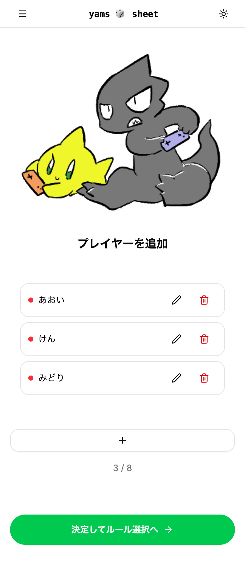
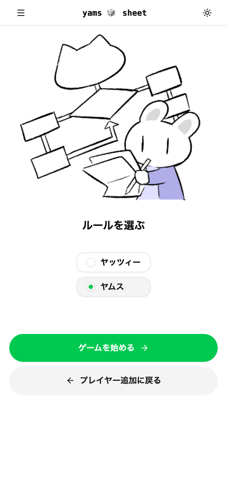
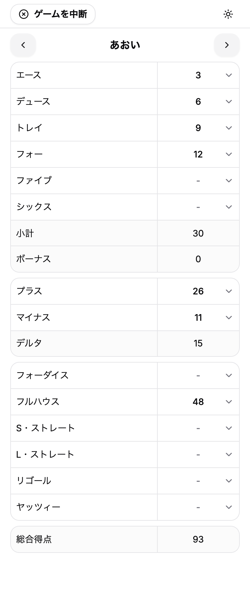
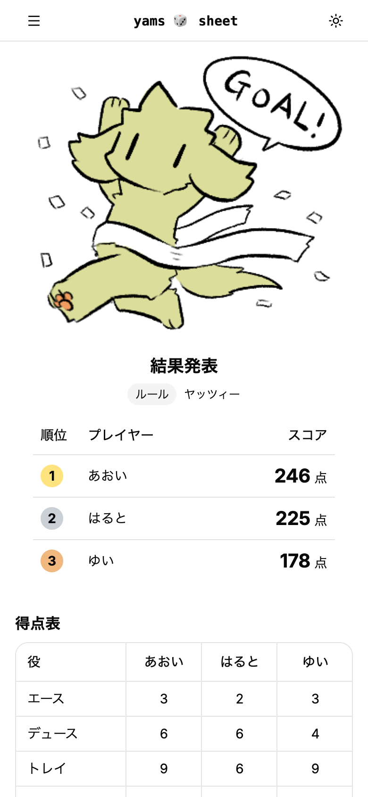
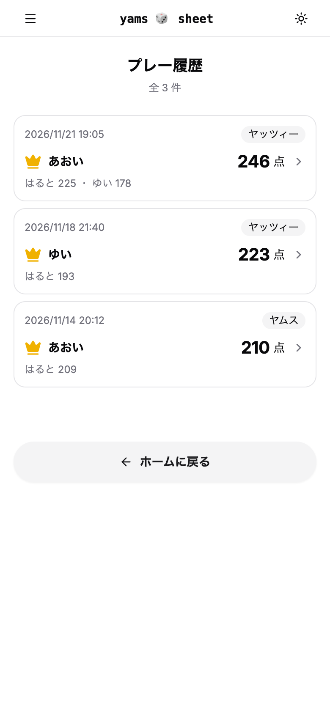
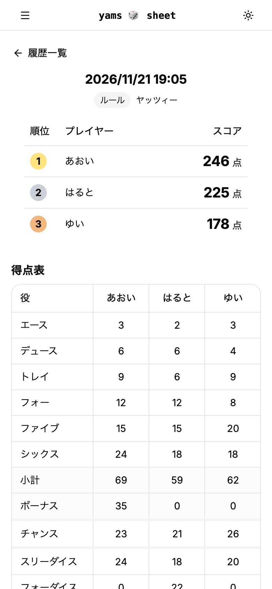

# yahtzee-scoresheet

ダイスゲームの得点表をスマートフォンのブラウザで付けるための Web アプリです。
ヤッツィーと、その派生ルールであるヤムスに対応しています。

https://yahtzee-scoresheet-five.vercel.app

| プレイヤー追加 | ルール選択 | 得点入力 |
| --- | --- | --- |
|  |  |  |

| 結果発表 | プレー履歴 | 履歴の詳細 |
| --- | --- | --- |
|  |  |  |

## 機能

- ルールはヤッツィーとヤムスから選べます。ヤムスではプラスとマイナスの差（デルタ）やリゴールといった独自の役を記録できます。
- 得点の入力は役ごとに取りうる点数の一覧から選ぶだけです。小計、ボーナス、総合得点は自動で計算されます。
- プレイヤーは最大 8 人まで登録できます。得点表の上部の矢印でプレイヤーを切り替えられるので、1 台の端末を回して使えます。
- 入力した得点は端末内に保存されます。ページを再読み込みしたりタブを閉じたりしても、途中から再開できます。
- 終了したゲームはプレー履歴に残ります。過去のゲームの順位と、役ごとの得点表をあとから見返せます。不要な履歴は削除できます。
- 右上のボタンで、ライトモード、ダークモード、システム設定に合わせる表示を切り替えられます。

## 使い方

1. プレイヤーを追加し、名前を付けます。
2. ルールを選び、ゲームを始めます。
3. 各プレイヤーの役ごとに得点を選びます。
4. すべての欄が埋まると、左上のボタンが「ゲームを中断」から「ゲームを終了」に変わります。終了すると、順位と役ごとの得点表を載せた結果発表が表示されます。
5. 終了したゲームは「プレー履歴」から見返せます。プレー履歴は、ゲーム中以外の画面で左上のメニュー（≡）を開くと選べます。履歴は詳細画面の「この履歴を削除」から 1 件ずつ削除できます。

途中で「ゲームを中断」を選ぶと、入力中の得点を破棄してプレイヤー追加の画面に戻ります。

## データの保存について

得点とプレイヤーの情報はブラウザの IndexedDB に保存します。
サーバには送信しません。
そのため、別の端末やブラウザとは記録を共有できません。
また、ブラウザのサイトデータを削除すると記録も消えます。

終了したゲームの結果も保存し、プレー履歴として表示します。
「ゲームを中断」で抜けたゲームは、入力中の得点が破棄され、プレー履歴にも残りません。

## 開発

### 必要なもの

- Node.js 26.x
- pnpm 10
- lefthook（pre-commit フックを使う場合）

### セットアップと起動

画像の取得には、プロジェクトに接続された Vercel Blob のトークンが必要です。
Vercel CLI でプロジェクトをリンクし、環境変数を取得してください。

```sh
vercel link
vercel env pull .env.local
```

取得済みの画像が `app/assets/` にある場合は、トークンがなくても起動できます。

```sh
pnpm install
pnpm dev
```

開発サーバは http://localhost:5173 で起動します。

Docker イメージをビルドする場合は、`BLOB_READ_WRITE_TOKEN` を環境変数に設定し、BuildKit の secret として渡します。

```sh
docker build --secret id=blob_token,env=BLOB_READ_WRITE_TOKEN .
```

pre-commit フックを有効にするには、lefthook を別途インストールしてから次を実行します。
コミット時に、ステージしたファイルへ `biome check --write` がかかります。

```sh
lefthook install
```

### コマンド

| コマンド | 内容 |
| --- | --- |
| `pnpm dev` | 開発サーバを起動する |
| `pnpm build` | 本番用にビルドする（出力先は `build/`） |
| `pnpm start` | ビルド結果をサーバで起動する（既定のポートは 3000 で、`PORT` で変更できる） |
| `pnpm test` | Vitest でテストを実行する |
| `pnpm typecheck` | ルートの型を生成してから型検査する |
| `pnpm lint` | Biome で lint する |
| `pnpm format` | Biome でフォーマットを確認する |

GitHub Actions ではプルリクエストと `main` への push のたびに `pnpm test` を実行します。
